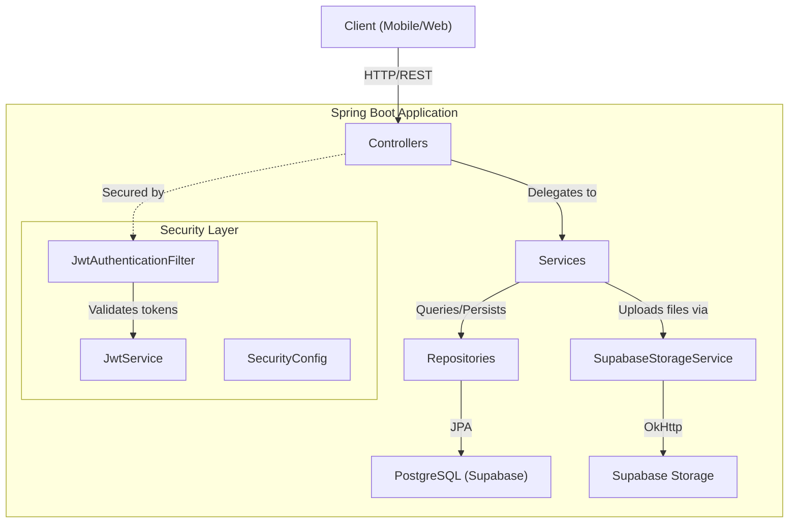
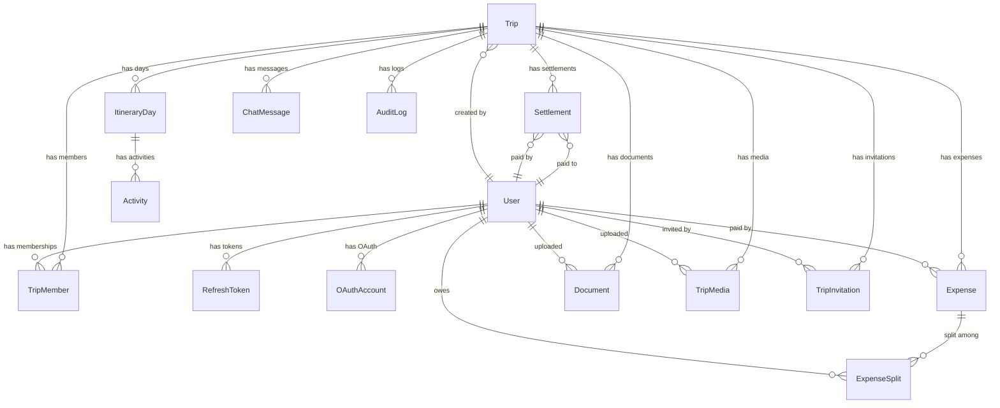

# 🗺️ TripTrack Backend — Comprehensive Project Report

## Project Overview

**TripTrack** (package: `com.tripnext`) is a collaborative trip planning and management REST API built with **Spring Boot 4.1.0** and **Java 21**. It enables users to create trips, invite members, plan daily itineraries with activities, track and split group expenses, upload documents/media, and more — all secured with JWT-based authentication.

> [!NOTE]
> **Database**: PostgreSQL (hosted on Supabase)
> **File Storage**: Supabase Storage (documents + media)
> **Schema Management**: Flyway migrations
> **Session Strategy**: Fully stateless (JWT)

---

## Tech Stack Summary

| Layer | Technology | Version |
|---|---|---|
| Framework | Spring Boot | 4.1.0 |
| Language | Java | 21 |
| Database | PostgreSQL (Supabase) | — |
| ORM | Spring Data JPA / Hibernate | — |
| Auth | JWT (jjwt) | 0.12.6 |
| Security | Spring Security | — |
| Migrations | Flyway | — |
| File Storage | Supabase Storage (via OkHttp) | — |
| HTTP Client | OkHttp | 4.12.0 |
| Reactive | Spring WebFlux (dependency present) | — |
| WebSocket | Spring WebSocket (dependency present) | — |
| Caching | Spring Data Redis (dependency present) | — |
| Code Gen | Lombok | — |
| Env Config | spring-dotenv | 5.1.0 |
| Cloud SDK | AWS S3 SDK (dependency present) | 2.31.63 |

---

## Architecture Overview



---

## Package Structure

```
com.tripnext.demo
├── config/                  # Security, JWT, Supabase configuration
├── controller/              # REST API controllers (8 controllers)
├── dto/                     # Data Transfer Objects (records)
│   ├── auth/                # Auth request/response DTOs
│   ├── document/            # Document & media DTOs
│   ├── expense/             # Expense, settlement, balance DTOs
│   ├── invitation/          # Invitation DTOs
│   ├── itinerary/           # Itinerary day & activity DTOs
│   ├── notification/        # Notification DTOs (stub)
│   ├── trip/                # Trip & member DTOs
│   └── user/                # User profile DTOs
├── exception/               # Custom exceptions + global handler
├── model/                   # JPA entities (15 entities)
│   └── help/                # Enums (9 enums)
├── repo/                    # Spring Data JPA repositories (17 repos)
├── security/                # CustomUserDetailsService
├── service/                 # Business logic services (8 services)
│   └── storage/             # File storage interface + Supabase impl
└── util/                    # Utility classes (TokenHashUtil)
```

---

## Domain Model (Entities)



### Entity Details

| Entity | Table | Key Fields | Notes |
|---|---|---|---|
| [User](file:///c:/trip-track/backend/demo/src/main/java/com/tripnext/demo/model/User.java) | `users` | id, name, email, passwordHash, profileImageUrl, status | Email indexed, timestamps with `@PrePersist`/`@PreUpdate` |
| [Trip](file:///c:/trip-track/backend/demo/src/main/java/com/tripnext/demo/model/Trip.java) | `trips` | id, title, description, destination, startDate, endDate, createdBy | References creating user |
| [TripMember](file:///c:/trip-track/backend/demo/src/main/java/com/tripnext/demo/model/TripMember.java) | `trip_members` | id, trip, user, role, joinedAt | Role: OWNER / ADMIN / MEMBER |
| [TripInvitation](file:///c:/trip-track/backend/demo/src/main/java/com/tripnext/demo/model/TripInvitation.java) | `trip_invitations` | id, trip, invitedBy, tokenHash, role, expiresAt, usageLimit, usageCount, isRevoked | Token-based invite link system |
| [ItineraryDay](file:///c:/trip-track/backend/demo/src/main/java/com/tripnext/demo/model/ItineraryDay.java) | `itinerary_days` | id, trip, dayNumber, date, title, notes | Ordered by day number |
| [Activity](file:///c:/trip-track/backend/demo/src/main/java/com/tripnext/demo/model/Activity.java) | `activities` | id, itineraryDay, createdBy, title, location, lat/lng, startTime, endTime, estimatedCost, orderIndex, version | Optimistic locking via `@Version` |
| [Expense](file:///c:/trip-track/backend/demo/src/main/java/com/tripnext/demo/model/Expense.java) | `expenses` | id, trip, paidBy, amount, title, description, category | Category enum (FOOD, TRANSPORT, etc.) |
| [ExpenseSplit](file:///c:/trip-track/backend/demo/src/main/java/com/tripnext/demo/model/ExpenseSplit.java) | `expense_splits` | id, expense, user, splitAmount | Equal-split expense tracking |
| [Settlement](file:///c:/trip-track/backend/demo/src/main/java/com/tripnext/demo/model/Settlement.java) | `settlements` | id, trip, paidBy, paidTo, amount | Records debt payments between members |
| [Document](file:///c:/trip-track/backend/demo/src/main/java/com/tripnext/demo/model/Document.java) | `documents` | id, trip, uploadedBy, fileName, fileUrl, documentType, fileSizeBytes | Types: FLIGHT_TICKET, HOTEL_BOOKING, PASSPORT, VISA, INSURANCE, OTHER |
| [TripMedia](file:///c:/trip-track/backend/demo/src/main/java/com/tripnext/demo/model/TripMedia.java) | `trip_media` | id, trip, uploadedBy, fileUrl, mediaFileType, caption | Types: PHOTO, VIDEO |
| [RefreshToken](file:///c:/trip-track/backend/demo/src/main/java/com/tripnext/demo/model/RefreshToken.java) | `refresh_tokens` | id, user, tokenHash, expiresAt, isRevoked | SHA-256 hashed tokens |
| [IdempotencyKey](file:///c:/trip-track/backend/demo/src/main/java/com/tripnext/demo/model/IdempotencyKey.java) | `idempotency_keys` | id, key, resourceId, resourceType | Prevents duplicate expense creation |
| [ChatMessage](file:///c:/trip-track/backend/demo/src/main/java/com/tripnext/demo/model/ChatMessage.java) | `chat_messages` | — | Entity exists (placeholder) |
| [AuditLog](file:///c:/trip-track/backend/demo/src/main/java/com/tripnext/demo/model/AuditLog.java) | `audit_logs` | — | Entity exists (placeholder) |
| [Notification](file:///c:/trip-track/backend/demo/src/main/java/com/tripnext/demo/model/Notification.java) | `notifications` | — | Entity exists (placeholder) |
| [OAuthAccount](file:///c:/trip-track/backend/demo/src/main/java/com/tripnext/demo/model/OAuthAccount.java) | `oauth_accounts` | — | Entity exists (Google OAuth placeholder) |

### Enums

| Enum | Values |
|---|---|
| `UserStatus` | ACTIVE, INACTIVE, SUSPENDED |
| `TripMemberRole` | OWNER, ADMIN, MEMBER |
| `TripRole` | OWNER, ADMIN, MEMBER |
| `ExpenseCategory` | FOOD, TRANSPORT, HOTEL, SHOPPING, ACTIVITY, OTHER |
| `DocType` | FLIGHT_TICKET, HOTEL_BOOKING, PASSPORT, VISA, INSURANCE, OTHER |
| `MediaFileType` | PHOTO, VIDEO |
| `InvitationStatus` | PENDING, ACCEPTED, REJECTED |
| `NotificationType` | TRIP_INVITATION, EXPENSE_ADDED, EXPENSE_SETTLED, DOCUMENT_UPLOADED, CHAT_MESSAGE, TRIP_UPDATED, GENERAL |
| `OAuthProvider` | GOOGLE |

---

## API Endpoints — Complete Reference

### 1. Authentication (`/api/auth`) — Public

| Method | Endpoint | Description | Controller |
|---|---|---|---|
| `POST` | `/api/auth/register` | Register new user (returns access + refresh tokens) | [AuthController](file:///c:/trip-track/backend/demo/src/main/java/com/tripnext/demo/controller/AuthController.java) |
| `POST` | `/api/auth/login` | Login with email/password | [AuthController](file:///c:/trip-track/backend/demo/src/main/java/com/tripnext/demo/controller/AuthController.java) |
| `POST` | `/api/auth/refresh` | Refresh access token using refresh token | [AuthController](file:///c:/trip-track/backend/demo/src/main/java/com/tripnext/demo/controller/AuthController.java) |
| `POST` | `/api/auth/logout` | Revoke refresh token (logout) | [AuthController](file:///c:/trip-track/backend/demo/src/main/java/com/tripnext/demo/controller/AuthController.java) |

### 2. User Profile (`/api/users`) — Authenticated

| Method | Endpoint | Description | Controller |
|---|---|---|---|
| `GET` | `/api/users/me` | Get current user's profile | [UserController](file:///c:/trip-track/backend/demo/src/main/java/com/tripnext/demo/controller/UserController.java) |
| `PUT` | `/api/users/me` | Update profile (name, profile image) | [UserController](file:///c:/trip-track/backend/demo/src/main/java/com/tripnext/demo/controller/UserController.java) |

### 3. Trips (`/api/trips`) — Authenticated

| Method | Endpoint | Description | Access | Controller |
|---|---|---|---|---|
| `GET` | `/api/trips` | List all trips for current user | Any member | [TripController](file:///c:/trip-track/backend/demo/src/main/java/com/tripnext/demo/controller/TripController.java) |
| `POST` | `/api/trips` | Create a new trip | Any authenticated user | [TripController](file:///c:/trip-track/backend/demo/src/main/java/com/tripnext/demo/controller/TripController.java) |
| `GET` | `/api/trips/{tripId}` | Get trip details | Trip member | [TripController](file:///c:/trip-track/backend/demo/src/main/java/com/tripnext/demo/controller/TripController.java) |
| `PATCH` | `/api/trips/{tripId}` | Update trip details | Owner only | [TripController](file:///c:/trip-track/backend/demo/src/main/java/com/tripnext/demo/controller/TripController.java) |
| `DELETE` | `/api/trips/{tripId}` | Delete trip | Owner only | [TripController](file:///c:/trip-track/backend/demo/src/main/java/com/tripnext/demo/controller/TripController.java) |
| `GET` | `/api/trips/{tripId}/members` | List trip members | Trip member | [TripController](file:///c:/trip-track/backend/demo/src/main/java/com/tripnext/demo/controller/TripController.java) |
| `DELETE` | `/api/trips/{tripId}/members/{userId}` | Remove a member | Owner only | [TripController](file:///c:/trip-track/backend/demo/src/main/java/com/tripnext/demo/controller/TripController.java) |
| `PATCH` | `/api/trips/{tripId}/members/{userId}/role` | Change member role | Owner only | [TripController](file:///c:/trip-track/backend/demo/src/main/java/com/tripnext/demo/controller/TripController.java) |
| `POST` | `/api/trips/{tripId}/leave` | Leave a trip | Non-owner member | [TripController](file:///c:/trip-track/backend/demo/src/main/java/com/tripnext/demo/controller/TripController.java) |
| `PATCH` | `/api/trips/{tripId}/owner` | Transfer ownership | Owner only | [TripController](file:///c:/trip-track/backend/demo/src/main/java/com/tripnext/demo/controller/TripController.java) |

### 4. Invitations — Authenticated

| Method | Endpoint | Description | Access | Controller |
|---|---|---|---|---|
| `POST` | `/api/trips/{tripId}/invitations` | Create invite link | Owner only | [TripController](file:///c:/trip-track/backend/demo/src/main/java/com/tripnext/demo/controller/TripController.java) |
| `GET` | `/api/trips/{tripId}/invitations` | List invitations | Owner only | [TripController](file:///c:/trip-track/backend/demo/src/main/java/com/tripnext/demo/controller/TripController.java) |
| `POST` | `/api/invitations/accept?token=...` | Accept invite via token | Any authenticated user | [InvitationController](file:///c:/trip-track/backend/demo/src/main/java/com/tripnext/demo/controller/InvitationController.java) |
| `DELETE` | `/api/invitations/{invitationId}` | Revoke invitation | Owner only | [InvitationController](file:///c:/trip-track/backend/demo/src/main/java/com/tripnext/demo/controller/InvitationController.java) |

### 5. Itinerary & Activities (`/api/trips/{tripId}/days`) — Authenticated

| Method | Endpoint | Description | Access | Controller |
|---|---|---|---|---|
| `GET` | `.../days` | List itinerary days | Trip member | [ItineraryDayController](file:///c:/trip-track/backend/demo/src/main/java/com/tripnext/demo/controller/ItineraryDayController.java) |
| `POST` | `.../days` | Create itinerary day | Owner/Admin | [ItineraryDayController](file:///c:/trip-track/backend/demo/src/main/java/com/tripnext/demo/controller/ItineraryDayController.java) |
| `PATCH` | `.../days/{dayId}` | Update itinerary day | Owner/Admin | [ItineraryDayController](file:///c:/trip-track/backend/demo/src/main/java/com/tripnext/demo/controller/ItineraryDayController.java) |
| `DELETE` | `.../days/{dayId}` | Delete itinerary day | Owner/Admin | [ItineraryDayController](file:///c:/trip-track/backend/demo/src/main/java/com/tripnext/demo/controller/ItineraryDayController.java) |
| `POST` | `.../days/{dayId}/activities` | Create activity | Owner/Admin | [ItineraryDayController](file:///c:/trip-track/backend/demo/src/main/java/com/tripnext/demo/controller/ItineraryDayController.java) |
| `PATCH` | `.../api/activities/{activityId}` | Update activity | Owner/Admin | [ItineraryDayController](file:///c:/trip-track/backend/demo/src/main/java/com/tripnext/demo/controller/ItineraryDayController.java) |
| `DELETE` | `.../api/activities/{activityId}` | Delete activity | Owner/Admin | [ItineraryDayController](file:///c:/trip-track/backend/demo/src/main/java/com/tripnext/demo/controller/ItineraryDayController.java) |
| `GET` | `.../days/itinerary` | Get full itinerary (days + activities) | Trip member | [ItineraryDayController](file:///c:/trip-track/backend/demo/src/main/java/com/tripnext/demo/controller/ItineraryDayController.java) |

### 6. Expenses (`/api/trips/{tripId}/expenses`) — Authenticated

| Method | Endpoint | Description | Access | Controller |
|---|---|---|---|---|
| `GET` | `.../expenses` | List expenses (paginated) | Trip member | [ExpenseController](file:///c:/trip-track/backend/demo/src/main/java/com/tripnext/demo/controller/ExpenseController.java) |
| `POST` | `.../expenses` | Create expense (with idempotency key) | Trip member | [ExpenseController](file:///c:/trip-track/backend/demo/src/main/java/com/tripnext/demo/controller/ExpenseController.java) |
| `PATCH` | `.../expenses/{expenseId}` | Update expense | Expense creator only | [ExpenseController](file:///c:/trip-track/backend/demo/src/main/java/com/tripnext/demo/controller/ExpenseController.java) |
| `DELETE` | `.../expenses/{expenseId}` | Delete expense | Expense creator only | [ExpenseController](file:///c:/trip-track/backend/demo/src/main/java/com/tripnext/demo/controller/ExpenseController.java) |
| `GET` | `.../expenses/balances` | Get who-owes-whom balances | Trip member | [ExpenseController](file:///c:/trip-track/backend/demo/src/main/java/com/tripnext/demo/controller/ExpenseController.java) |
| `POST` | `.../expenses/settlements` | Record a settlement payment | Trip member | [ExpenseController](file:///c:/trip-track/backend/demo/src/main/java/com/tripnext/demo/controller/ExpenseController.java) |
| `GET` | `.../expenses/settlements` | List settlements | Trip member | [ExpenseController](file:///c:/trip-track/backend/demo/src/main/java/com/tripnext/demo/controller/ExpenseController.java) |
| `GET` | `.../expenses/settlements/suggestions` | Get optimal settlement suggestions | Trip member | [ExpenseController](file:///c:/trip-track/backend/demo/src/main/java/com/tripnext/demo/controller/ExpenseController.java) |

### 7. Documents & Media (`/api/trips/{tripId}`) — Authenticated

| Method | Endpoint | Description | Access | Controller |
|---|---|---|---|---|
| `POST` | `.../documents` | Upload document (multipart) | Trip member | [DocumentController](file:///c:/trip-track/backend/demo/src/main/java/com/tripnext/demo/controller/DocumentController.java) |
| `GET` | `.../documents` | List documents | Trip member | [DocumentController](file:///c:/trip-track/backend/demo/src/main/java/com/tripnext/demo/controller/DocumentController.java) |
| `GET` | `.../documents/{documentId}` | Get document by ID | Any authenticated | [DocumentController](file:///c:/trip-track/backend/demo/src/main/java/com/tripnext/demo/controller/DocumentController.java) |
| `DELETE` | `.../documents/{documentId}` | Delete document | Owner/Admin | [DocumentController](file:///c:/trip-track/backend/demo/src/main/java/com/tripnext/demo/controller/DocumentController.java) |
| `POST` | `.../media` | Upload media (photo/video, multipart) | Trip member | [DocumentController](file:///c:/trip-track/backend/demo/src/main/java/com/tripnext/demo/controller/DocumentController.java) |
| `GET` | `.../media` | List media | Trip member | [DocumentController](file:///c:/trip-track/backend/demo/src/main/java/com/tripnext/demo/controller/DocumentController.java) |
| `GET` | `.../media/{mediaId}` | Get media by ID | Any authenticated | [DocumentController](file:///c:/trip-track/backend/demo/src/main/java/com/tripnext/demo/controller/DocumentController.java) |
| `DELETE` | `.../media/{mediaId}` | Delete media | Owner/Admin | [DocumentController](file:///c:/trip-track/backend/demo/src/main/java/com/tripnext/demo/controller/DocumentController.java) |

### 8. Test (`/api/test`)

| Method | Endpoint | Description |
|---|---|---|
| `GET` | `/api/test` | Returns "JWT Working" (health check) |

**Total: ~38 API endpoints implemented**

---

## Feature Deep-Dive

### 🔐 Authentication & Security

- **Registration**: Email/password with BCrypt hashing, returns access + refresh JWT tokens
- **Login**: Validates credentials, issues new token pair
- **Token Refresh**: Validates refresh token (not expired, not revoked), issues new access token
- **Logout**: Revokes refresh token by setting `isRevoked = true`
- **JWT Filter** ([JwtAuthenticationFilter](file:///c:/trip-track/backend/demo/src/main/java/com/tripnext/demo/config/JwtAuthenticationFilter.java)): Intercepts all requests, extracts Bearer token, validates, and sets `SecurityContext`
- **Token Hashing**: Refresh tokens stored as SHA-256 hashes via [TokenHashUtil](file:///c:/trip-track/backend/demo/src/main/java/com/tripnext/demo/util/TokenHashUtil.java) (security best practice ✅)
- **Access Token Expiry**: 15 minutes (900,000 ms)
- **Refresh Token Expiry**: 7 days (604,800,000 ms)
- **Public endpoints**: Only `/api/auth/**` is unauthenticated
- **Session**: Fully stateless (`SessionCreationPolicy.STATELESS`)

### 🧳 Trip Management

- Full CRUD for trips with ownership model
- **Role-based access**: OWNER → ADMIN → MEMBER hierarchy
- Owner-only operations: update trip, delete trip, manage members, create/revoke invitations
- **Ownership transfer**: Demotes current owner to ADMIN, promotes target to OWNER
- **Leave trip**: Members can leave (owners cannot, must transfer first)
- Date validation: End date cannot precede start date

### ✉️ Invitation System

- **Token-based invite links**: Random UUID → SHA-256 hash stored in DB
- **Usage limits**: Configurable max uses per invitation
- **Expiry**: Invitations expire after 7 days
- **Revocation**: Owners can revoke any invitation
- **Duplicate protection**: Cannot join a trip you're already a member of
- Link format: `http://localhost:8080/api/invitations/accept?token=<raw-uuid>`

### 📅 Itinerary Planning

- **Day-based structure**: Each trip has ordered itinerary days
- **Activities per day**: Ordered activities with location, lat/lng, time range, estimated cost
- **Optimistic locking**: Activities use `@Version` to prevent concurrent edit conflicts
- **Validations**: Day number > 0, date within trip range, end time after start time, no negative costs, unique order indices
- **Admin access**: Only OWNER/ADMIN can create/update/delete days and activities; all members can view

### 💰 Expense Tracking & Splitting

- **Create expenses**: With title, description, category, amount, and participant list
- **Equal splitting**: Amount divided equally among selected participants
- **Idempotency**: `Idempotency-Key` header prevents duplicate expense creation
- **Balance calculation**: Tracks who owes whom across all expenses and settlements
- **Settlement recording**: Members can record payments to settle debts
- **Settlement suggestions**: Algorithm computes minimum transactions to settle all debts (greedy debtor-creditor matching)
- **Pagination**: Expenses support paginated listing
- **Ownership**: Only the expense creator can update/delete their expenses
- **Validations**: Amount > 0, title required, no duplicate participants, all participants must be trip members

### 📄 Document & Media Management

- **Document uploads**: PDF, JPEG, PNG supported (max 10 MB)
- **Media uploads**: Any image/video type (max 50 MB)
- **Supabase Storage**: Files uploaded via OkHttp PUT requests with service key auth
- **File path strategy**: `{tripId}/{uuid}-{originalFilename}`
- **Two storage buckets**: `docs` for documents, `tripfiles` for media
- **RBAC for deletion**: Only OWNER/ADMIN can delete files
- **File validation**: [FileValidator](file:///c:/trip-track/backend/demo/src/main/java/com/tripnext/demo/service/FileValidator.java) enforces type and size constraints

---

## Error Handling

Centralized via [GlobalExceptionHandler](file:///c:/trip-track/backend/demo/src/main/java/com/tripnext/demo/exception/GlobalExceptionHandler.java) (`@RestControllerAdvice`):

| Exception | HTTP Status | Use Case |
|---|---|---|
| `ResourceNotFoundException` | 404 | Entity not found |
| `BadRequestException` | 400 | Invalid input (e.g., duplicate email) |
| `UnauthorizedException` | 401 | Insufficient permissions |
| `Exception` (fallback) | 500 | Unexpected errors → "Something went wrong" |

Response format:
```json
{
  "message": "...",
  "timestamp": "2026-09-09T14:30:00Z"
}
```

---

## Database & Configuration

### Application Properties ([application.properties](file:///c:/trip-track/backend/demo/src/main/resources/application.properties))

- `spring.jpa.hibernate.ddl-auto=validate` — Schema managed by Flyway, Hibernate only validates
- `spring.jpa.show-sql=true` — SQL logging enabled
- `spring.flyway.enabled=true` — Flyway migrations enabled
- Environment variables loaded from [.env](file:///c:/trip-track/backend/demo/.env) via `spring-dotenv`

### Flyway Migrations

| Migration | Purpose |
|---|---|
| [V2__remove_s3_key_from_documents.sql](file:///c:/trip-track/backend/demo/src/main/resources/db/migration/V2__remove_s3_key_from_documents.sql) | Drops `s3_key` column from documents table (migrated away from S3) |

> [!IMPORTANT]
> The V1 migration is missing from the repository — the initial schema was likely created directly in Supabase or via another mechanism. Only V2 exists, which removes an S3-related column.

---

## File & Code Statistics

| Category | Count |
|---|---|
| JPA Entities | 15 |
| Enums | 9 |
| Controllers | 8 |
| Services | 8 (+ 1 interface) |
| Repositories | 17 |
| DTOs | 30+ (Java records) |
| Custom Exceptions | 3 |
| API Endpoints | ~38 |
| Total Java Files | ~90 |

---

## Features with Entities But No Implementation Yet (Stubs/Placeholders)

| Feature | Entity Exists | DTO Exists | Service Exists | Controller Exists |
|---|---|---|---|---|
| Chat Messages | ✅ `ChatMessage` | ❌ | ❌ | ❌ |
| Notifications | ✅ `Notification` | ✅ `NotificationResponse` (empty) | ❌ | ❌ |
| Audit Logging | ✅ `AuditLog` | ❌ | ❌ | ❌ |
| OAuth (Google) | ✅ `OAuthAccount` | ❌ | ❌ | ❌ |
| WebSocket (real-time) | — (dependency added) | ❌ | ❌ | ❌ |
| Redis caching | — (dependency added) | ❌ | ❌ | ❌ |
| File delete from Supabase | — | — | ✅ (stub: `// implement later`) | — |

---

## What You've Accomplished ✅

1. **Full authentication system** — Register, login, refresh, logout with secure JWT + hashed refresh tokens
2. **Complete trip lifecycle** — CRUD, role-based access (OWNER/ADMIN/MEMBER), ownership transfer
3. **Robust invitation system** — Token-based links with expiry, usage limits, and revocation
4. **Day-by-day itinerary planner** — With ordered activities, geo-coordinates, time ranges, cost estimates, and optimistic locking
5. **Full expense management** — Create, split equally, track balances, record settlements, and get settlement suggestions with a debt-minimization algorithm
6. **Document & media uploads** — Supabase Storage integration with file validation, two separate buckets
7. **Centralized error handling** — Consistent error responses across all endpoints
8. **Security best practices** — Stateless JWT, BCrypt passwords, SHA-256 token hashing, RBAC enforcement
9. **Idempotency for expenses** — Prevents double-charge from network retries
10. **Clean layered architecture** — Controller → Service → Repository with proper separation of concerns
11. **Modern Java patterns** — Records for DTOs, Lombok for boilerplate, Java 21

> [!TIP]
> This is a substantial and well-structured backend. The core features (auth, trips, itinerary, expenses, files) are fully functional. The placeholder entities (chat, notifications, audit, OAuth) show you've planned for future expansion.
